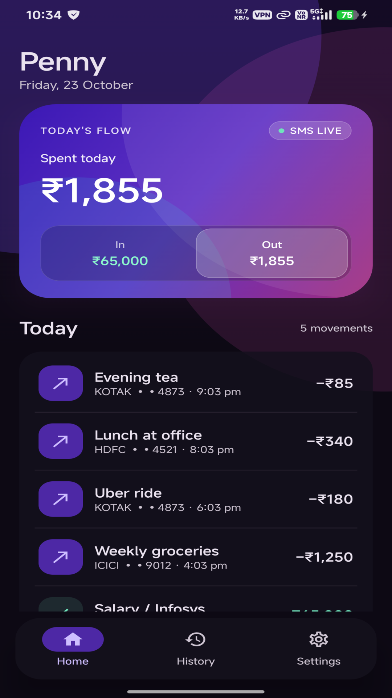
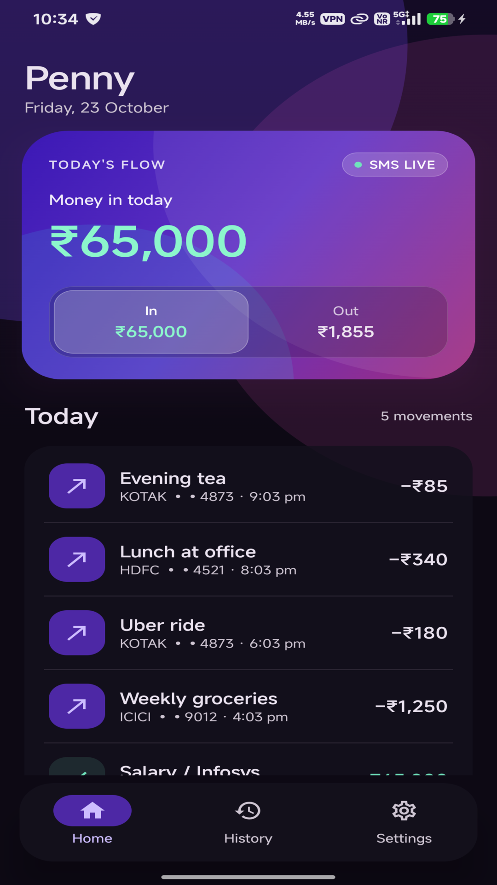
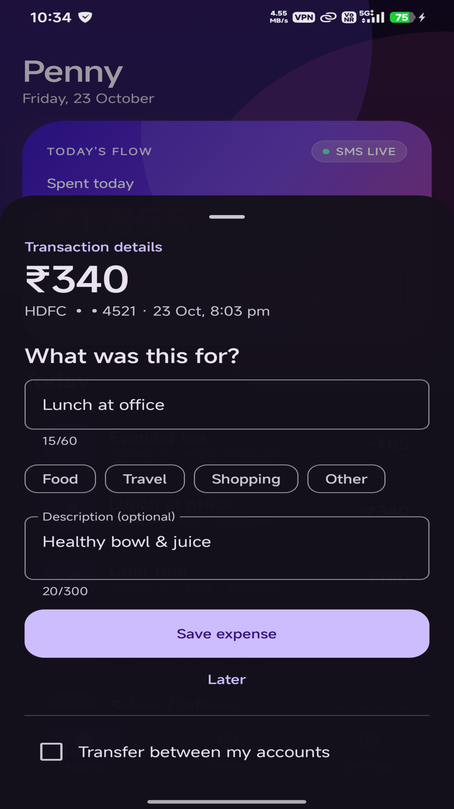
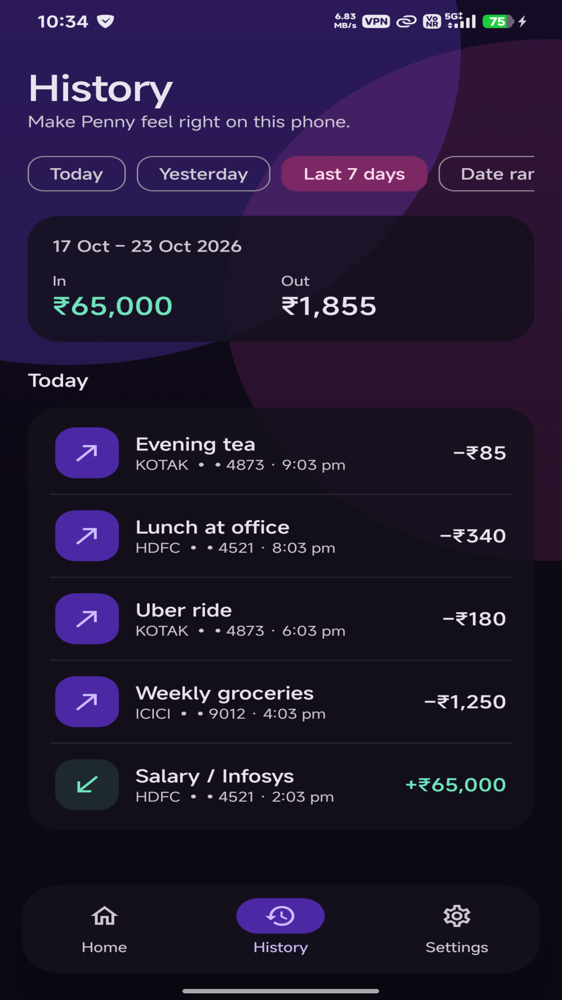
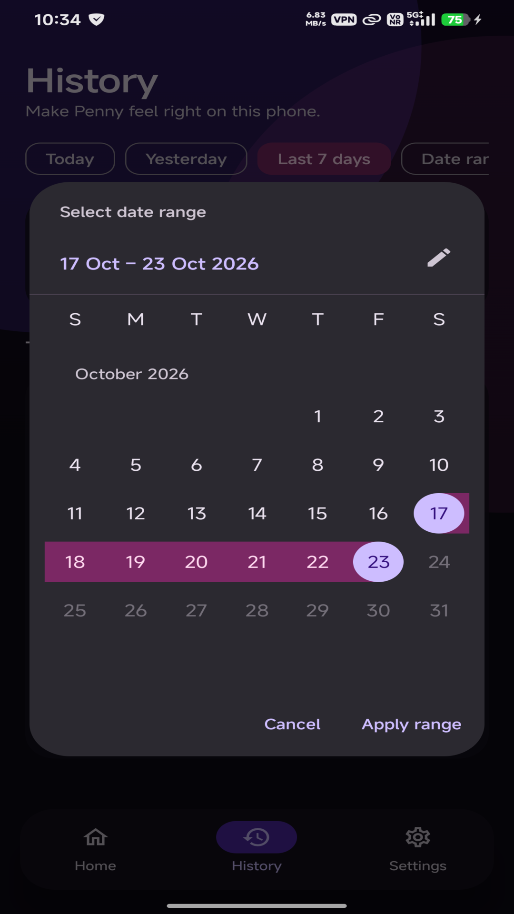
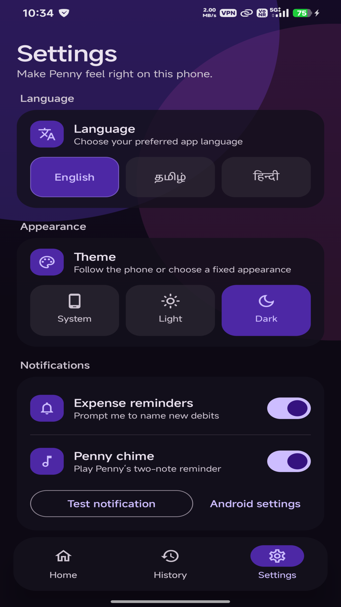

<div align="center">


# Penny – Luminous Local-First Money Tracker

**A private, offline Android ledger shaped by aurora glass and fast financial legibility.**

[](https://android.com)
[](https://kotlinlang.org)
[](https://developer.android.com/jetpack/compose)
[](https://developer.android.com/training/data-storage/room)
[-00A86B?style=flat)](#zero-cloud-guarantee)
[](LICENSE)

[**Live Privacy Policy**](https://abi-de-jo.github.io/penny/) • [**App Architecture**](#architecture) • [**Getting Started**](#getting-started)

</div>

---

## 🌟 Overview

**Penny** turns everyday bank and UPI alerts into an elegant, readable financial ledger without requiring manual data entry or cloud accounts. 

Instead of a generic wall of equal cards, Penny views everyday financial movement through a luminous **"Liquid Ledger"** aurora glass canopy with instant cash-flow visibility.

### 🛡️ Zero-Cloud Guarantee
* **No `INTERNET` Permission**: Check `AndroidManifest.xml` — Penny does not declare `android.permission.INTERNET`. The Android operating system physically forbids network transmission.
* **100% On-Device SQLite**: All movements, categories, titles, notes, and preferences live in `/data/data/com.penny.app/databases/penny.db`.
* **Zero Bank Credentials**: Penny never asks for net banking passwords, card PINs, CVV, OTPs, or UPI MPINs.
* **No Trackers or Ads**: Zero telemetry, zero analytics SDKs, zero advertising frameworks.

---

## ✨ Features

- **⚡ Dual Capture Engine**:
  - **Carrier SMS Parser**: Recognizes debit and credit alerts from all major Indian banks (HDFC, SBI, ICICI, Kotak, Axis, PNB, Canara, IndusInd, Bank of Baroda).
  - **Payment App Listener**: Captures push notifications directly from Google Pay, PhonePe, Paytm, and CRED when banks do not send SMS for micro-transactions.
  - **Cross-Alert Deduplication**: Uses 12-digit UPI UTR / RRN numbers to prevent duplicate entries if both SMS and app notification arrive.
- **🌊 Liquid Aurora Balance Card**:
  - Dominant asymmetric balance lobe with pearl light bloom and cyan sea undertow.
  - Dynamic display typography scaling from 24sp to 46sp to handle 1 to 7+ digit figures (`₹1` to `₹99,99,999`) without clipping.
  - Simplified, spacious **`In`** and **`Out`** toggle with spring physics animation.
- **🔐 Biometric Swipe-to-Delete**:
  - Swipe any transaction right to reveal a curved, jewel-like aurora ruby delete tray.
  - Deletion is guarded by Android’s hardware **`BiometricPrompt`** (Fingerprint, Face unlock, or Device Lock Screen PIN/Pattern).
- **📅 Custom Date Range Picker**:
  - Filter timeline by **Today**, **Yesterday**, **Last 7 days**, or a custom **From–To Date Range**.
  - Built with native Material 3 `DateRangePicker` with calendar range highlighting and live period inflow/outflow totals.
- **🌐 Trilingual Localization**:
  - Full first-class support for **English**, **தமிழ் (Tamil)**, and **हिन्दी (Hindi)** with instant, zero-lag switching.
- **🎨 Glassmorphic Themes**:
  - Responsive **System**, **Light** (cool lavender paper), and **Dark** (deep violet-black) modes.
  - Translucent glass toast notifications with swipe-to-dismiss gesture.

---

## 📱 App Screenshots

<div align="center">
<table>
  <tr>
    <td align="center"><strong>Home Screen (Spent Today)</strong></td>
    <td align="center"><strong>Inflow State (Money In)</strong></td>
    <td align="center"><strong>Expense Naming &amp; Tags</strong></td>
  </tr>
  <tr>
    <td></td>
    <td></td>
    <td></td>
  </tr>
  <tr>
    <td align="center"><strong>History &amp; Period Totals</strong></td>
    <td align="center"><strong>Custom Date Range Picker</strong></td>
    <td align="center"><strong>Settings &amp; Multi-Language</strong></td>
  </tr>
  <tr>
    <td></td>
    <td></td>
    <td></td>
  </tr>
</table>
</div>

---

## 🏛️ Architecture

```
com.penny.app
├── data/
│   ├── PennyDatabase.kt          # Room SQLite Database
│   ├── TransactionDao.kt         # CRUD queries & deduplication indices
│   ├── TransactionEntity.kt      # Direction, Kind, Amount, Account, UTR
│   ├── TransactionRepository.kt  # Clean repository pattern
│   └── PennyPreferences.kt       # Jetpack DataStore (Theme, Language, Sound)
├── notifications/
│   ├── ExpenseNotifications.kt   # High-priority reminder channel & Penny chime
│   └── PennyNotificationListener.kt # NotificationListenerService for GPay/PhonePe
├── sms/
│   ├── TransactionSmsReceiver.kt # BroadcastReceiver for incoming bank SMS
│   └── TransactionSmsParser.kt   # 4-stage multi-bank parsing pipeline
└── ui/
    ├── MainActivity.kt           # Complete Jetpack Compose UI
    ├── PennyStrings.kt           # Trilingual strings catalog (EN, TA, HI)
    └── theme/
        └── PennyTheme.kt         # Aurora violet/magenta/cyan design tokens
```

---

## 🚀 Getting Started

### Prerequisites
- Android Studio Ladybug / Meerkat or newer
- JDK 17+
- Android SDK with API 36 (minSdk 26)

### Build & Run
```bash
# Clone the repository
git clone https://github.com/Abi-de-jo/penny.git
cd penny

# Build release APK
./gradlew assembleRelease testDebugUnitTest

# Install on a connected USB device / emulator via ADB
adb install -r app/build/outputs/apk/release/app-release.apk

# Launch
adb shell am start -n com.penny.app/.MainActivity
```

---

## 🔒 Privacy Policy

The official Privacy Policy for Penny is hosted on GitHub Pages:  
👉 **[https://abi-de-jo.github.io/penny/](https://abi-de-jo.github.io/penny/)**

*(Alternative standalone file: [`PRIVACY_POLICY.md`](PRIVACY_POLICY.md))*

---

## 📄 License

Distributed under the MIT License. See `LICENSE` for more information.
